<!-- Os cards são SVGs animados gerados por scripts/gerar_cards.py, em versão clara e escura.
     Para mudar texto, idade ou tecnologias, edite o topo do script e rode: python scripts/gerar_cards.py
     O espaçamento já vem nos SVGs: mantenha este bloco sem linhas em branco e os cards de uma
     mesma fileira na mesma linha, sem espaços entre eles. -->

<a href="https://www.linkedin.com/in/henrique-godoy-dos-santos/"><picture><source media="(prefers-color-scheme: dark)" srcset="./cards/hero-dark.svg" /></picture></a> 
<picture><source media="(prefers-color-scheme: dark)" srcset="./cards/stack-dark.svg" /></picture> 
<picture><source media="(prefers-color-scheme: dark)" srcset="./cards/titulo-projetos-dark.svg" /></picture> 
<a href="https://github.com/HenriqueGodoyy/Natacao_Unaerp"><picture><source media="(prefers-color-scheme: dark)" srcset="./cards/repo-Natacao_Unaerp-dark.svg" /></picture></a><a href="https://github.com/HenriqueGodoyy/Portifolio"><picture><source media="(prefers-color-scheme: dark)" srcset="./cards/repo-Portifolio-dark.svg" /></picture></a><a href="https://github.com/HenriqueGodoyy/mobile-security"><picture><source media="(prefers-color-scheme: dark)" srcset="./cards/repo-mobile-security-dark.svg" /></picture></a> 
<a href="https://www.linkedin.com/in/henrique-godoy-dos-santos/"><picture><source media="(prefers-color-scheme: dark)" srcset="./cards/contato-linkedin-dark.svg" /></picture></a><a href="https://instagram.com/henrique_godoy12"><picture><source media="(prefers-color-scheme: dark)" srcset="./cards/contato-instagram-dark.svg" /></picture></a><a href="mailto:henriquegodoyds@gmail.com"><picture><source media="(prefers-color-scheme: dark)" srcset="./cards/contato-email-dark.svg" /></picture></a>

### 🤖 Estatísticas

